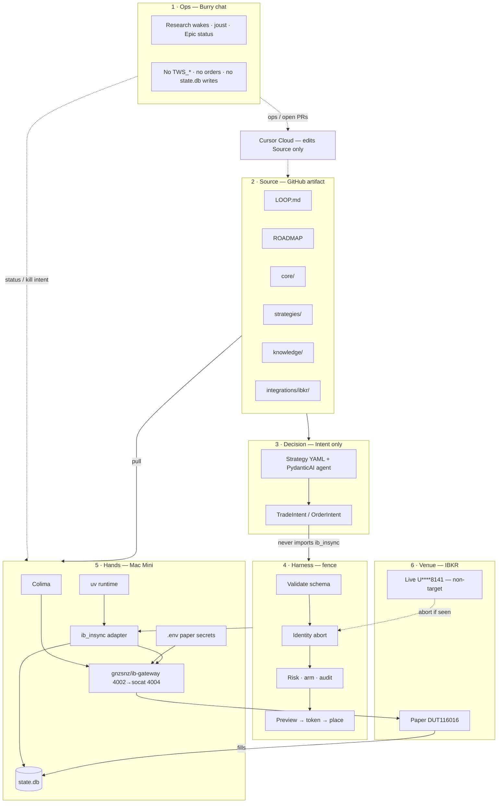

# Options-trading-bot architecture

Source of truth for planes, tools, and boundaries. Amended with Zishan 2026-09-12.
Product-in-force (structure / closes) locked with Will 2026-11-11: see
[`exit-strategy.md`](exit-strategy.md) and [`STATUS.md`](../../STATUS.md)
walking-slice Epic 6. This diagram is harness planes, not the strategy YAML.

## Diagram

Paper **DUT116016** is the testing-period risk cap (equity/margin). Mask any
live account id as `U****8141`. Never copy TWS secrets or `.env`.

## Tool opinions (Zishan)

| Tool | Verdict | Notes |
|---|---|---|
| Colima + Docker | Keep | Isolates Gateway; Mini only |
| gnzsnz/ib-gateway | Keep (pin digest) | Paper 4002→4004; no live in same compose |
| ib_insync | Keep | Execution adapter only; strategies never import |
| uv | Keep | Mini toolchain + lockfile |
| SQLite state.db | Keep | Mini only |
| PydanticAI | Keep, scope-lock | Decision → intents; not harness gates |
| Strategy YAML | Keep | Cloud edits; Mini loads |

## In force vs as-built (2026-11-11)

- **In force:** standard RR (short put + long call), no protective put, no
  defined max loss, no automated yellow-zone exits, manual flatten only.
- **As-built:** `strategies/active/us-large-cap-rr.yaml` is the loaded
  standard RR. `spy-defined-risk-rr.yaml` remains as superseded/historical.
- Watchlist (`strategies/watchlist.yaml`) exists for Epic 5 research intake.
  The runner does not load it.

## Gaps not to draw as shipped

These are remaining harness gaps, not a Day-1 snapshot:

- Epic 0 paper fill: **done** (2026-10-06, DUT116016). See
  [`2026-10-06-epic0-paper-fill.md`](2026-10-06-epic0-paper-fill.md).
- Identity + GuardedBroker + mock broker + idempotency + paper flatten: **done**.
- Still open: stale-quote reject, constraint 3 autonomy latch, live arming.
- Walking-slice Epic 4 Mini paper demo (reconcile / debrief / manual flatten)
  is remaining evidence. Automated 21-DTE / −$1,250 / +$1,000 exits are
  **not** that demo — they are deferred to Epic 6.
